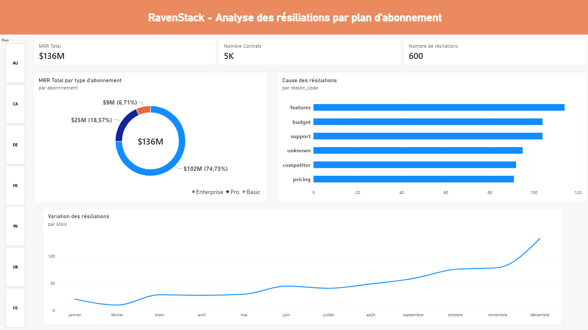

# SaaS Analytics & Corporate Finance : Diagnostic MRR & Rétention (RavenStack)

[← Retour au portfolio](https://solenesct.github.io/)

---

## 📌 Synthèse Exécutive

### Contexte & Problématique Métier
**RavenStack** est un éditeur SaaS B2B comptabilisant 5 000 abonnements et un volume d'affaires cumulé de **11,34 M$ de MRR**.  
L'enjeu de cette étude était d'auditer la rentabilité de la croissance, la structure des revenus par formule et les causes racines de l'attrition (*churn*) sans biais d'agrégation temporelle.

### Chiffres Clés
* **MRR Total souscrit :** 11 338 747 $ (5 000 contrats analysés).
* **Concentration Enterprise :** **74,7 % du MRR total** est généré par seulement 34,5 % des comptes (ARPU de ~4 918 $).
* **Trajectoire Net New MRR :** Strictement positive sur l'ensemble de la période, dépassant **+300 k$ nets/mois** dès le premier trimestre 2024.
* **Churn MRR qualifié :** ~6,13 M$ évaporés sur 545 résiliations reliées à un contrat actif.

### Enseignements Métier & Recommandations
1. **L'objection produit prime sur l'objection tarifaire :**  
   Le manque de fonctionnalités (`features`) constitue la cause **#1** de perte financière (**1,33 M$ de MRR détruit**), alors que le prix direct (`pricing`) n'arrive qu'en dernière position (**801 k$**).
2. **Vulnérabilité du Service Client :**  
   Le motif `support` représente près de 100 départs et plus de **1,05 M$ perdus**.
3. **Recommandations stratégiques :**  
   * Réorienter la roadmap produit sur les fonctionnalités réclamées par le segment Enterprise.  
   * Mettre en place une équipe Customer Success dédiée aux comptes à fort ARPU pour désamorcer l'insatisfaction support avant résiliation.

---

## 📊 Dashboard Interactif

---

## 📁 Scripts SQL sources

* 🔗 [Consulter 01_schema_and_cleaning.sql sur GitHub](https://github.com/solenesct/solenesct.github.io/blob/main/SaaS/01_schema_and_cleaning.sql)
* 🔗 [Consulter 02_mrr_analysis.sql sur GitHub](https://github.com/solenesct/solenesct.github.io/blob/main/Saas/02_mrr_analysis.sql)

---

## 🛠️ Approche Technique & Modélisation SQL

Pour cette analyse, plusieurs défis d'intégrité de données ont été traités :

* **Résolution du fan-out (produit cartésien) :** Un compte pouvant avoir plusieurs contrats successifs, la jointure sur les événements de churn a été strictement bornée dans le temps pour éviter la duplication artificielle des métriques :
<pre><code class="language-sql">ON c.account_id = s.account_id 
AND c.churn_date &gt;= s.start_date 
AND (s.end_date IS NULL OR c.churn_date &lt;= s.end_date)</code></pre>
* **Cohérence temporelle (Net New MRR) :** Utilisation de CTEs mensuelles et de `COALESCE` pour réconcilier les flux d'acquisition et d'attrition sans perdre les mois sans churn.
* **Segmentation & Root Cause :** Agrégation multidimensionnelle par code motif (`reason_code`) pour quantifier financièrement l'impact produit vs pricing.

👉 *L'ensemble des requêtes de nettoyage, CTEs et calculs avancés est consultable dans les fichiers sources ci-dessus.*

